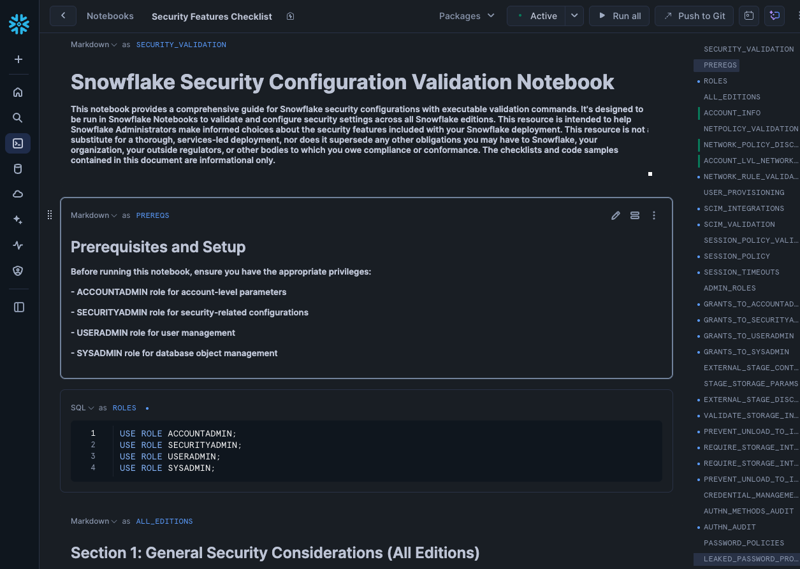

# Security-Features-Checklist

**Snowflake Security Configuration Validation Notebook**

The Snowflake Security Configuration Validation Notebook helps administrators validate and secure their Snowflake accounts using native platform features. The notebook runs read-only SQL checks that assess security configuration across all Snowflake editions. Most checks report a ✅ / ⚠️ / ❌ status alongside the raw configuration.

Use it to:

- Identify security gaps and misconfigurations
- Prepare for the deprecation of single-factor passwords
- Validate authentication methods, policies, and credentials
- Assess alignment with security best practices and the Trust Center scanners

> **Important**: This resource is informational only and does not replace professional services, compliance obligations, or formal security audits.

## Getting started

1. In Snowsight, import `Security_Features_Checklist.ipynb` into a Workspace or Notebook.
2. Run it as **ACCOUNTADMIN**, or as a role with `IMPORTED PRIVILEGES` on the `SNOWFLAKE` database (or the `SECURITY_VIEWER` / `GOVERNANCE_VIEWER` database roles) plus `MONITOR` on the account.
3. Run the cells top to bottom. Every check is read-only, and example remediation SQL is commented out.

`ACCOUNT_USAGE` views can lag by up to 2 hours.

## Coverage

**0. Trust Center**: Open findings from the Security Essentials, CIS Benchmark, and Threat Intelligence scanners.

**1. All editions**
- Account and organization naming
- Network policies and network rules (flags legacy IP lists and service users without a policy)
- User provisioning (SCIM), user `TYPE` hygiene, and stale users
- Session policies
- Administrative roles: holders, default roles, MFA posture, inheritance, and ACCOUNTADMIN count
- Data exfiltration parameters (`PREVENT_UNLOAD_TO_INLINE_URL`, `PREVENT_LOAD_FROM_INLINE_URL`, `REQUIRE_STORAGE_INTEGRATION_*`, `PREVENT_UNLOAD_TO_INTERNAL_STAGES`, `DISABLE_UI_DOWNLOAD_BUTTON`), plus external stages with embedded credentials
- Authentication:
  - Strong-authentication readiness and single-factor password logins
  - Auth method usage and failed-login hotspots
  - SAML / OAuth / External OAuth integrations and privileged-role blocking
  - Authentication policies, using the new `MFA_POLICY` syntax
  - MFA coverage (passkey, TOTP, Duo) and password policies
  - Service user methods (Workload Identity Federation, key pair, PAT) and PAT lifecycle
- Managed access schemas (all databases) and grants to `PUBLIC`
- External access integrations, egress network rules, and secrets
- Cortex AI governance: `CORTEX_USER` grants, model allowlist, cross-region inference, Cortex Code limits, MCP read-only, and agents
- Error-message redaction parameters

**2. Enterprise Edition**
- Time Travel and retention
- Periodic data rekeying
- Sensitive data classification, tags, and coverage of masking, row access, projection, aggregation, and join policies
- Classified columns with no masking policy
- Access history on sensitive objects

**3. Business Critical Edition**
- Private connectivity configuration and authorized endpoints
- Internal stage private connectivity (AWS, Azure, GCP)
- Tri-Secret Secure / customer-managed keys (self-service)
- Replication, failover groups (checks whether users and roles are included), and Client Redirect

## What changed in v0.4.0

- **Strong authentication:** Added the single-factor password deprecation timeline, `LEGACY_SERVICE` retirement, readiness checks, and the Strong Authentication Hub.
- **Authentication policy examples:** Updated to the current `MFA_POLICY` syntax (`MFA_AUTHENTICATION_METHODS` and `MFA_ENROLLMENT='OPTIONAL'` are deprecated), and fixed the smart quotes that broke the old examples.
- **New sections:** Trust Center, Cortex AI and agent governance, error redaction, external access egress, access history, and classification coverage.
- **Checks now use `ACCOUNT_USAGE.USERS` posture columns** (`HAS_MFA`, `HAS_PAT`, `HAS_WORKLOAD_IDENTITY`, `TYPE`) instead of relying only on login history.
- **PAT review:** Lists every token with expiry, last-used, lifetime, and role restriction. This replaces the old aggregate, which had a bug where `EXPIRED` was never assigned.
- **Bug fixes:**
  - SCIM query had a trailing comma.
  - Managed-access check only scanned the `SNOWFLAKE` database.
  - Azure internal-stage check referenced a parameter that doesn't exist; it now uses `SYSTEM$INTERNAL_STAGES_PUBLIC_ACCESS_STATUS`.
  - GCP internal-stage private connectivity is now documented as supported.
  - Removed the duplicate session-policy section.
  - Added checks for parameters that were described but never checked (MFA caching, ID token, MFA nudge).
- **Parameter checks:** Use the `->>` pipe operator to compare current and recommended values in a single cell.

## Support

- Submit feedback to **safe@snowflake.com**
- Review Snowflake's [security documentation](https://docs.snowflake.com/en/guides-overview-secure)
- Consult your Snowflake account team

## License & disclaimer

This notebook is provided as-is for informational purposes. It does not supersede any obligations to Snowflake, your organization, regulators, or compliance bodies. Always validate findings and consult with security professionals for critical deployments.
